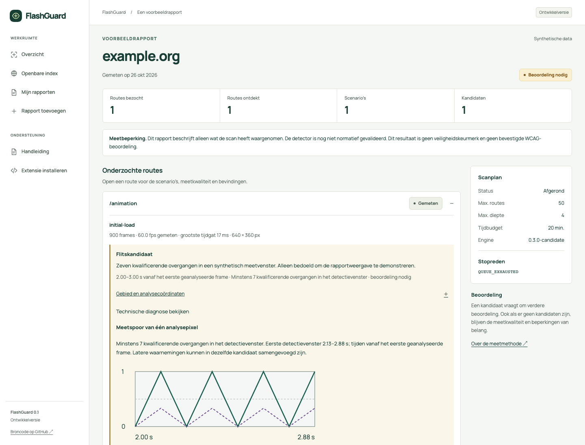

# epi-less

**Find and investigate flashing web content, directly in Chrome.**

epi-less scans websites locally, records when and where suspicious changes occur, and gives you measurements to investigate them. Start capture from the toolbar; follow and control the same scan in DevTools. Keep reports on your device, export them, or deliberately share a reviewed snapshot through the web application.

A community project for investigating flashing web content. Contributions to detection, accessibility and documentation are welcome.

> **Development preview · repository temporarily private.** Access is required to clone or contribute. The local P0 workflow runs; scanner 0.4 remains a candidate implementation with unresolved capture and validation gates. There is no official hosted service or Chrome Web Store release yet. A public, community-developed project remains the intention. The scanner produces review candidates, not a validated WCAG verdict or medical safety guarantee.

[Quickstart](#quickstart) · [First scan](#your-first-scan) · [Detection quality](#detection-quality) · [Contributing](#contributing) · [Documentation](#documentation)

## What you can do

- **Scan automatically.** Discover same-origin routes, scroll through content and exercise supported menus, tabs, disclosures, carousel states and muted media. Bounded focus, delayed-state observations and samples across existing seekable video loops extend the plan; the optional advanced build adds real browser hover in its own temporary scan tab. A bounded compact profile uses a temporary background window; the ordinary scan returns its tab, while the advanced scan closes its own tab after stopping or finishing; unsupported or interrupted states remain explicit. Quick and extended modes observe just the current viewport.
- **Investigate a finding.** Read static luminance/red-ratio plots, exact RGB samples and simultaneous pixel-area evidence. A bounded DOM timeline adds geometry, mutations, animation timing and video position near the estimated event window. Open a retained original element in DevTools while its local reference remains valid.
- **Check a proposed fix.** Save a local review, rerun the recorded scenario and compare compatible measurements. Rechecks must cover the original document/animation phase and, for video, the recorded clip interval and presentation sequence. Missing or poor-quality evidence cannot resolve an issue. Keep local history and export standalone HTML or JSON without replaying suspect content.
- **Share deliberately.** Review routes, text and optional diagnostics before choosing private, unlisted or public visibility. Manage links, withdraw reports and search the public index in your own running instance.



_Actual application UI with synthetic example data. The graph is static; this is not an audit of example.org._

## Quickstart

You need **Node.js 24.19.0**, **pnpm 11.13.1**, Git and access to this repository. Use Chrome to run the extension. Chrome 116 is the API minimum; the recorded native capture tests use Chrome for Testing 156 on macOS, not a full browser/OS compatibility matrix.

### 1. Start the local web application

```sh
git clone https://github.com/Orka-digital/epiless.git
cd epiless
pnpm install --frozen-lockfile
pnpm setup:local
pnpm dev
```

Open **<http://localhost:4321>**. The [example report](http://localhost:4321/voorbeeld/) lets you explore the interface before scanning anything.

Setup creates local configuration and applies local D1 migrations. No Cloudflare login, production credentials or remote database is needed. There is no demo account: create one at `/account` when you want to test sharing. Development uses a local challenge fixture and sends no email, so email-based password recovery is unavailable locally.

### 2. Build and load the extension

In a second terminal, from the repository root:

```sh
EPI_LESS_WEB_URL=http://localhost:4321 pnpm --filter @epi-less/chrome-extension build
```

Open `chrome://extensions`, enable **Developer mode**, choose **Load unpacked**, and select **`apps/chrome-extension/dist`**. Pin epi-less to the toolbar.

Scanning itself needs neither an account nor a running epi-less web server. The web application is used to publish and manage shared reports.

<details>
<summary>Using a different local port</summary>

Keep the configured web origin, extension build and browser tests aligned:

```sh
EPI_LESS_PORT=4387 pnpm setup:local
EPI_LESS_PORT=4387 pnpm dev
```

In the second terminal:

```sh
EPI_LESS_WEB_URL=http://localhost:4387 pnpm --filter @epi-less/chrome-extension build
```

Open `http://localhost:4387`. Rebuild and reload the extension when its publication origin changes. Also prefix later `pnpm build` and `pnpm dev:extension` commands with `EPI_LESS_WEB_URL=http://localhost:4387`; otherwise they rebuild for the default port. For browser checks, also set `EPI_LESS_PORT=4387` on web tests and `EPI_LESS_WEB_URL=http://localhost:4387` on extension tests.

</details>

## Your first scan

1. Open a normal HTTP(S) website you intend to inspect. The autonomous scanner navigates the **current tab in your current browser session**.
2. Open epi-less from the toolbar, choose **Hele website · automatisch** and select **Scan deze website**. Quick and extended modes use **Start viewportmeting** instead. Grant the requested browser permission. The current interface is in Dutch.
3. Let the runner explore supported routes and interactions. You can follow progress, pause or stop; captured segments remain available.
4. Open a finding's **Technische diagnose bekijken** panel. Check its measurements together with frame quality, observed scenarios and skipped work.
5. Export locally, or choose **Uploadvoorbeeld openen** to review a snapshot in the web application. Nothing is published by opening that preview.

The optional [advanced build](apps/chrome-extension/README.md#optional-advanced-interactions) prepares a separate scan tab and requires a real toolbar start on that tab. It keeps your original page intact. After that authorization, exploration and cleanup are automatic.

The default autonomous budget is 50 routes, depth 4, 20 minutes and 12 actions per route. Form submissions, transaction-like actions, unsupported controls and blocked states are excluded by policy. These limits are recorded; they do not establish complete site coverage. See the [extension guide](apps/chrome-extension/README.md) for supported actions and capture constraints.

## Detection quality

The engine looks for general luminance and saturated-red flash candidates in captured pixels. Reports distinguish the result from whether the runner finished its plan:

| Report status        | Meaning                                                         |
| -------------------- | --------------------------------------------------------------- |
| `NEEDS_REVIEW`       | Candidates were observed and need investigation.                |
| `NO_ISSUES_OBSERVED` | No candidates were observed in the measured scope.              |
| `INCONCLUSIVE`       | Capture or coverage was insufficient for a reliable conclusion. |

The [result glossary](docs/SCANNER-QUALITY.md#result-glossary) explains candidates, partial coverage and targeted recheck outcomes with examples.

A stopped or failed runner can still retain useful segments; inspect its job state and stop reason separately. Every report keeps `passed: null`. Read the findings even when a report is inconclusive: insufficient capture does not erase an observed candidate. A completed route plan is not a safety or conformance verdict.

Engine **0.4.0-candidate** preserves native pixels within a **2,073,600-pixel budget** (1920 × 1080) and bounds retained analysis state to 256 MiB. Larger sources are rescaled and disclosed. Its bundled WASM kernel preserves Float64 calculations and shared histories. Current changes retain one complete spatial witness and constrain source clues to the actual event window; numeric regressions and real Chrome control-flow tests cover these changes.

On this Mac, recorded build **`6770f520…`** passes controlled desktop and compact captures of a tiny video candidate over a dense background and from an encoded VP9 file, around 60 fps. A separate native signal → fixed video → signal recheck preserves all **53 actual frame-presentation timestamps** across the same clip. That build's comparison reports **not observed** after the fix and **reobserved** after its return. This is one controlled seekable-video case, not general video or hardware validation.

The subsequent replay guard records document and animation clocks: reloading a page and measuring too early must not miss an unchanged delayed effect and count as repair evidence. A fresh native chain on **`7fc0a67c…`** passes the stricter comparison: **307/315/315 frames near 60 fps at 1800 × 1126**, all 53 video presentations and complete original document-interval coverage, with **not observed → reobserved** after fix and recurrence. This proves that selected scenario on this Mac; the baseline whole-site scan remains partial. Older scans lack phase evidence and cannot support a new negative comparison. The dashboard explains missing phase/media evidence and shows the measured timing; historical reports and reviews stay intact.

An existing-loop fixture also passes with 310 captured frames near 60 fps and two independently observed loop boundaries. It uses an artificial moving, low-contrast four-pixel marker; the whole job remains partial and inconclusive because other states were not reached. A bounded loop sample is not a whole-video test.

The earlier dense/encoded fixtures retain `MEDIA_REPLAY_NOT_REPRODUCIBLE`; their capture success does not erase missing replay evidence. Advanced cancellation releases resources, but exact CSS-height restoration still fails. The [quality record](docs/SCANNER-QUALITY.md) and [capture record](docs/CAPTURE_VALIDATION.md) preserve each fixture’s build identity, successes and failures. These results establish neither whole-site safety nor state-of-the-art performance.

DOM samples are collected during observation, with bounded read intervals and animation/video timing, then aligned through recorded per-frame receipt timestamps. The event window remains **estimated**. Capture-to-DOM latency remains unknown; these are source candidates and repair clues, not proof of which element flashed. Native observations sum simultaneous regions within W3C's **341 × 256 CSS-pixel reference field** at standard page and pinch zoom. Verified native DPR maps this to source pixels: **682 × 512 at DPR 2**. Rescaling, uncertain mapping, or a viewport/zoom change removes that reference comparison while retaining the pixel candidate. Actual screen geometry and viewing distance are not measured; this is not physical calibration or a WCAG verdict. Motion, fine-pattern hints and reference-area results never automatically dismiss a finding. Targeted rechecks require the same cold-build source fingerprint as well as compatible state, geometry and adequate capture.

Seekable file-video rechecks also require matching playback settings and the original, actually presented frame timestamps. Stalled, missing or uncertain presentations cannot support a negative comparison; live, unseekable or over-24-hour media are unsupported. The locally stored source-locator hash identifies an address, **not file contents**; editing a video at that address can be the fix. Playback metadata and replay plans stay local. A bounded loop sample is not a whole-video test, and “not observed again” never automatically means “resolved”.

The expanded independent TRACE numeric comparison scores **398 cases: 129 expected positives found, 0 missed, 18 extra candidates and 251 negatives matched**. Two malformed originals remain unscored. A separate lossless decoded-media comparison scores 36 cases against the upstream CSV labels: **14 found, 4 missed, 0 extra and 18 negatives matched**. The spatial corpus contains conflicting labels; the unchanged JSON labels and exact mask totals are also reported separately. These selected sets now serve as regression references, not real-world accuracy estimates. A [source-backed numeric review](docs/DETECTION-DISAGREEMENTS.md) explains the original staircase disagreements and the expanded set: seven transitions and complete peak-to-valley excursions matter; one delayed red excursion remains ambiguous. Original labels and scores stay unchanged.

```sh
pnpm validate:detection --check-baseline
pnpm validate:expanded --check-baseline
# Requires ffmpeg and ffprobe; encodes/decodes files without playing them.
pnpm validate:spatial-media --check-baseline
```

CI rejects new case-level disagreements without relabelling the external reference. Read the [reference method and licenses](tests/reference/README.md), [spatial/media evidence](tests/reference/trace-spatial/README.md), [scanner quality record](docs/SCANNER-QUALITY.md) and [native capture evidence](docs/CAPTURE_VALIDATION.md) for the exact scope and remaining gaps.

## Data and sharing

Frames are analysed locally. Raw video and screenshots are not persisted in reports; a finding can retain a bounded numeric trace from one representative pixel. Local history stays on the device unless you choose to export or share it.

Publication defaults replace route paths and redact original free text. Pixel traces, spatial details and source timelines require a separate diagnostic opt-in. Local inspection tokens, review notes and replay controls are not published; pseudonymized exports remove source timelines, media playback metadata and replay context. The preview shows exactly what will be sent; origin, timestamps, versions and basic measurements remain present. Approved uploads survive offline interruptions and remain bound to the approving account.

| Visibility | Access                                                         |
| ---------- | -------------------------------------------------------------- |
| Private    | The owner's authenticated session.                             |
| Unlisted   | Anyone holding the share link; excluded from the public index. |
| Public     | Publicly readable and eligible for the searchable index.       |

Withdrawal stops subsequent server access; downloaded copies remain outside the service's control. Removing local history and removing an online publication are separate actions. Repository visibility does not determine report visibility.

## Architecture and hosting

| Workspace                                              | Responsibility                                                                                               |
| ------------------------------------------------------ | ------------------------------------------------------------------------------------------------------------ |
| [`apps/chrome-extension`](apps/chrome-extension)       | Chrome MV3 runner, capture worker, toolbar/DevTools UI, local storage and exports.                           |
| [`packages/analysis-engine`](packages/analysis-engine) | Streaming pixel analysis, exact simultaneous masks and bounded temporal diagnostic traces.                   |
| [`packages/core`](packages/core)                       | Report contracts, validation, privacy policy helpers and static report rendering.                            |
| [`apps/web`](apps/web)                                 | Astro, focused React islands, accounts, report management and the searchable index on Cloudflare Workers/D1. |
| [`packages/rule-feed`](packages/rule-feed)             | Signed, versioned JSON feed with integrity, expiry and rollback checks.                                      |

Scans run on the user's device, avoiding hosted browser workers. Ordinary report pages need no application JavaScript. Turnstile and server-side rate limits protect account and publication flows; reading public reports does not require a challenge. See [self-hosting](docs/self-hosting.md) and the [cost model](docs/costs.md) for configuration and measured boundaries.

The **signed rule feed is groundwork for a later blocker**. Its approved rule set is empty; offline blocking and a durable updater are not implemented. The intended CDN feed is separate from access-controlled audit reports. Private and revocable reports must not enter a public static cache. Details are in the [feed protocol](packages/rule-feed/README.md).

## Development and checks

Run commands from the repository root. After local setup:

```sh
pnpm check
pnpm test
pnpm validate:detection --check-baseline
pnpm validate:expanded --check-baseline
pnpm build
```

For browser checks, **stop the local web server first**. The suites start their own preview or fixture on the configured port; run them sequentially after building:

```sh
pnpm exec playwright install chromium
pnpm test:web-quality
pnpm --filter @epi-less/chrome-extension test:browser
pnpm test:review-ui
```

`pnpm check` also checks unused code/dependencies and typechecks the JavaScript build, CI and validation helpers. The [codebase map](docs/CODEBASE.md) explains module ownership and the limits of these checks.

`pnpm verify:quickstart` combines local setup, checks, unit/integration tests and builds; browser checks are separate. For extension development, `pnpm dev:extension` watches TypeScript; reload the unpacked extension after changes. See [development notes](docs/development.md) for custom origins, native capture fixtures and troubleshooting.

The recorded `6770f520…` checkpoint passed `pnpm check`, **423 unit/integration tests across 45 files** and all seven then-current extension browser scripts. Later changes and their validation are tracked in the [implementation status](docs/IMPLEMENTATION.md). Native capture evidence has the separate scope described above.

The [CI workflow](.github/workflows/ci.yml) covers types, formatting, documentation, builds, tests, numeric and lossless-media detection regressions, and browser quality on pull requests and merge groups. The full spatial/media check requires FFmpeg; CI installs it explicitly. Workflow definitions are included; actual GitHub rules and release permissions are separate configuration. The [governance guide](GOVERNANCE.md) describes review and merge expectations.

## Contributing

While the repository is private, contributions are limited to people with access. Start with [CONTRIBUTING](CONTRIBUTING.md) and the [Code of Conduct](CODE_OF_CONDUCT.md). Useful work includes independently sourced detection cases, capture reliability, accessible diagnostics and documentation.

Keep a pull request focused on a concrete problem and show how the change was verified. Use synthetic data and numeric fixtures. Report security issues through the private channels described in [SECURITY](SECURITY.md); keep credentials, private browsing data and flashing recordings out of issues and CI artifacts.

## Documentation

Start with the [codebase map](docs/CODEBASE.md) for module ownership and maintenance checks, and the [validation map](docs/VALIDATION.md) to distinguish current gates from historical evidence.

| Looking for…                              | Read                                                                                                    |
| ----------------------------------------- | ------------------------------------------------------------------------------------------------------- |
| Implemented scope and remaining work      | [Implementation status](docs/IMPLEMENTATION.md) · [P0 acceptance map](docs/P0-ACCEPTANCE.md)            |
| Detection evidence and limitations        | [Scanner quality](docs/SCANNER-QUALITY.md) · [Reference comparison](tests/reference/README.md)          |
| Browser capture evidence                  | [Capture validation](docs/CAPTURE_VALIDATION.md)                                                        |
| Local setup and development               | [Development](docs/development.md) · [Extension guide](apps/chrome-extension/README.md)                 |
| Deployment, abuse protection and recovery | [Delivery](docs/DELIVERY.md) · [Turnstile](docs/abuse-protection.md) · [Operations](docs/operations.md) |
| Product decisions and changes             | [Dutch product specification](epi-less-audit.md) · [Changelog](CHANGELOG.md)                            |

## License and stewardship

Original code and documentation use the [MIT License](LICENSE). Dependencies and the [TRACE reference fixtures](tests/reference/trace-pse/upstream/LICENSE) retain their own licenses; see [third-party notices](docs/THIRD_PARTY_NOTICES.md).

Project credits: Orka Digital. See [governance](GOVERNANCE.md) for project stewardship and contributions.

Technical compatibility: legacy storage keys and signed-feed identifiers remain unchanged so existing local data and signatures stay valid. Historical validation artifacts retain their original bytes. The product and workspace packages use **epi-less**; local development variables use `EPI_LESS_*`.
